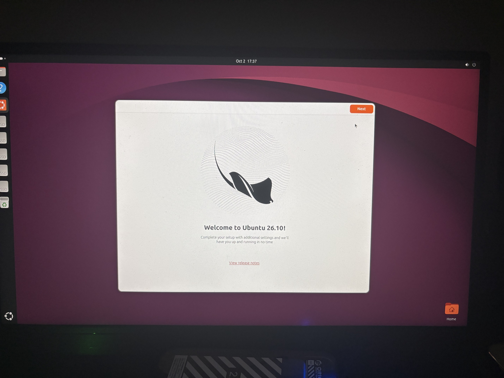
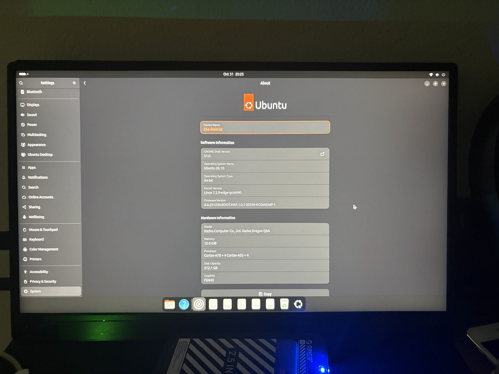
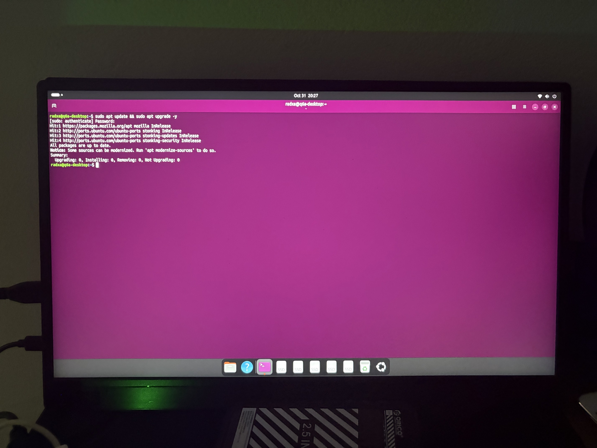

# Ubuntu 26.10 "Stonking Stingray" for the Radxa Dragon Q6A (experimental)



> **Experimental port.** Ubuntu 26.10 is an *interim* release (about 9 months of support, **not LTS**). This repository is a feasibility study that builds on what we learned in the stable project, [ubuntu-26.04.1-dragon-q6a](https://github.com/rafaelwms/ubuntu-26.04.1-dragon-q6a) (Ubuntu 26.04.1 LTS, kernel 7.2.9 / 6.18.2). If you want something to rely on, use that one.

🇧🇷 **[Leia em português mais abaixo](#português)**

---

## English

### What this is

Custom Ubuntu 26.10 images for the [Radxa Dragon Q6A](https://radxa.com/products/dragon/q6a/) (Qualcomm QCS6490), **Server** and **Desktop (GNOME 51)**, built with the same pipeline as the 26.04.1 project plus the fixes this release needed. It is part of the learning: most of the groundwork (bootloader layout, audio, Wi-Fi/BT, NPU runtime, first-boot resize) comes from the previous repository, and its research log (in Portuguese) is [docs/pesquisa.md over there](https://github.com/rafaelwms/ubuntu-26.04.1-dragon-q6a/blob/main/docs/pesquisa.md).

### What was tested (one board, one person)

| | Desktop | Server |
|---|---|---|
| Boots from external SSD over USB 3.0 | yes | built, not tested yet |
| HDMI | yes | not tested yet |
| Wi-Fi | shown connected in the top bar | not tested yet |
| Bluetooth | on, lists nearby devices | not tested yet |
| `apt update && apt upgrade` | yes, "All packages are up to date" (Mozilla + `stonking` repos, no snap) | not tested yet |
| Audio, NPU (`/dev/fastrpc-*`), long-term use, native NVMe boot | **not verified yet** | not tested yet |

Kernel: **Linux 7.2.9** (mainline, via Armbian `edge`, same as the stable project). Desktop: GNOME Shell 51.0, native Firefox (Mozilla `.deb`, no snap), `gnome-software`.





### Why not a newer kernel? (Ubuntu 26.10 itself ships Linux 7.3)

We tried **Linux 7.3.1** (rebasing the Armbian DisplayPort/DPU patch series onto it; 13 of 14 patches carried over, one is already upstream). It boots to userspace, but **no video**: `msm_dp_aux_isr: Unexpected DP AUX IRQ 0x00000008 when not busy` and `Cannot find any crtc or sizes`, the same signature other Q6A users reported for earlier 7.x kernels. So this release stays on 7.2.9. The rebased patches are kept in [`patches-qcs6490-7.3/`](patches-qcs6490-7.3/) as a starting point (`KERNEL_TAG=v7.3.1 scripts/00-build-kernel.sh`), for research only. See [docs/NOTES.md](docs/NOTES.md).

### Install

Download all `.part*` files of **one** image (Desktop or Server, do not mix), plus both `SHA256SUMS-*.txt`, from [Releases](../../releases), then run the interactive installer (verifies checksums, reassembles, asks you to confirm the target disk before writing):

```bash
./install.sh       # Linux
./install_mac.sh   # macOS (not run on a Mac by us)
```

Or by hand:

```bash
sha256sum -c SHA256SUMS-parts.txt --ignore-missing
cat radxa-dragon-q6a_stonking_<server|desktop>.img.xz.part* > image.img.xz
sha256sum -c SHA256SUMS-full.txt --ignore-missing
xzcat image.img.xz | sudo dd of=/dev/YOUR_DEVICE bs=4M status=progress conv=fsync
```

Default login `radxa` / `radxa` (change it with `passwd`). The root partition grows to fill the disk on first boot. The first-boot clock may show a wrong date until the network syncs it (the board has no battery RTC).

### Build from source

```bash
./scripts/build.sh
```

Needs Docker and about 25 GB free. The arm64 rootfs is built through `qemu-user` on an x86 host, which is single-threaded, so a full image takes roughly an hour.

### Fixes this release needed (vs. the 26.04.1 pipeline)

1. **Codename**: the rootfs is `debootstrap`-ed from `stonking`.
2. **Firefox/snapd**: in 26.10, `ubuntu-desktop-minimal` already *recommends* the transitional `firefox` package and `snapd`. The Firefox step now purges both, pins the Ubuntu `firefox*`/`snapd` to `-1`, and installs Mozilla's `.deb` with `--allow-downgrades`.
3. **`__u128` in the kernel headers**: 26.10's system `asm/ptrace.h` uses `__u128`, which the older `tools/include` copies inside the 7.2.9 `linux-headers` package do not define, so the headers' `postinst` (`resolve_btfids`) failed. The Wi-Fi step now unpacks, patches both `types.h` files and then configures the package.

### Credits

🤖 Built pair-programming with [Claude Code](https://claude.com/claude-code). License: [MIT](LICENSE).

---

## Português

### O que é

Imagens customizadas do Ubuntu 26.10 para a [Radxa Dragon Q6A](https://radxa.com/products/dragon/q6a/) (Qualcomm QCS6490), **Server** e **Desktop (GNOME 51)**. É um **port experimental**: o 26.10 é uma versão *interim* (cerca de 9 meses de suporte, **não é LTS**). Este repositório faz parte do aprendizado do projeto estável, o [ubuntu-26.04.1-dragon-q6a](https://github.com/rafaelwms/ubuntu-26.04.1-dragon-q6a) (26.04.1 LTS), de onde vem quase toda a base (bootloader, áudio, Wi-Fi/BT, NPU, redimensionamento no primeiro boot). Para uso sério, prefira aquele.

### O que foi testado (uma placa, uma pessoa)

Desktop, com kernel **7.2.9**: boot por SSD externo em USB 3.0 ✅, HDMI ✅, Wi-Fi mostrado como conectado ✅, Bluetooth ligado e listando dispositivos ✅, `apt update && apt upgrade` sem pendências e sem snap ✅. **Ainda não verificados:** áudio, NPU (`/dev/fastrpc-*`), uso prolongado e boot pelo slot NVMe nativo. **Server:** construído, ainda não testado em hardware.

### Por que não o kernel 7.3 (que o Ubuntu 26.10 usa)?

O **7.3.1** (com a série de patches de DisplayPort/DPU do Armbian rebaseada) sobe até o userspace, mas **sem vídeo**: `Unexpected DP AUX IRQ 0x00000008 when not busy` e `Cannot find any crtc or sizes`. Por isso esta release fica no **7.2.9**. Os patches rebaseados ficam em [`patches-qcs6490-7.3/`](patches-qcs6490-7.3/), só para pesquisa. Detalhes em [docs/NOTES.md](docs/NOTES.md).

### Instalar

Baixe todas as partes `.part*` de **uma** imagem (Desktop **ou** Server) e os dois `SHA256SUMS-*.txt` em [Releases](../../releases) e rode `./install.sh` (Linux) ou `./install_mac.sh` (macOS). Login padrão `radxa` / `radxa` (troque com `passwd`). A partição raiz cresce sozinha no primeiro boot.

### Correções que o 26.10 exigiu

Codinome `stonking` no `debootstrap`; `snapd` e Firefox de transição vindos do `ubuntu-desktop-minimal` (removidos, com pin `-1`, e Firefox nativo da Mozilla); e o tipo `__u128` nos cabeçalhos do kernel 7.2.9 (os dois `types.h` de `tools/` são corrigidos antes de configurar o pacote de headers).

### Créditos e licença

🤖 Construído em par com o [Claude Code](https://claude.com/claude-code). Licença [MIT](LICENSE).
